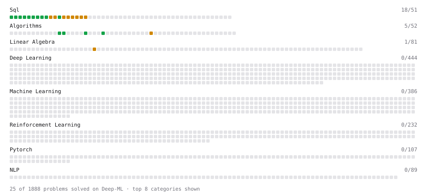

# Deep-ML

My machine learning practice from [Deep-ML](https://www.deep-ml.com). Every solution here was written by hand.

**31** solved · 28 problems · 0 labs · 3 math

[**Browse the interactive portfolio**](https://suryghosh.github.io/deep-ml/) to replay this filling in over time.

## Problems

| | Difficulty | Solved | |
| --- | --- | --- | --- |
| [Average per group](https://www.deep-ml.com/problems/1108) | easy | 2026-10-28 | [solution](problems/1108-average-per-group) |
| [Count rows per group](https://www.deep-ml.com/problems/1107) | easy | 2026-10-28 | [solution](problems/1107-count-rows-per-group) |
| [Count Words Appearing Exactly Once in Each of Two Lists](https://www.deep-ml.com/problems/1141) | easy | 2026-10-29 | [solution](problems/1141-count-words-appearing-exactly-once-in-each-of-two-lists) |
| [Delete Duplicate Emails Keeping One](https://www.deep-ml.com/problems/1112) | easy | 2026-10-29 | [solution](problems/1112-delete-duplicate-emails-keeping-one) |
| [Filter rows with WHERE](https://www.deep-ml.com/problems/1103) | easy | 2026-10-28 | [solution](problems/1103-filter-rows-with-where) |
| [First N Fibonacci Numbers](https://www.deep-ml.com/problems/1151) | easy | 2026-10-29 | [solution](problems/1151-first-n-fibonacci-numbers) |
| [Handle Missing Data in pandas (dropna/fillna)](https://www.deep-ml.com/problems/1128) | easy | 2026-11-05 | [solution](problems/1128-handle-missing-data-in-pandas-dropna-fillna) |
| [Remove duplicates with DISTINCT](https://www.deep-ml.com/problems/1105) | easy | 2026-10-28 | [solution](problems/1105-remove-duplicates-with-distinct) |
| [SELECT all rows](https://www.deep-ml.com/problems/1101) | easy | 2026-10-28 | [solution](problems/1101-select-all-rows) |
| [Select specific columns](https://www.deep-ml.com/problems/1102) | easy | 2026-10-28 | [solution](problems/1102-select-specific-columns) |
| [Sort results with ORDER BY](https://www.deep-ml.com/problems/1104) | easy | 2026-10-28 | [solution](problems/1104-sort-results-with-order-by) |
| [Top N with LIMIT](https://www.deep-ml.com/problems/1106) | easy | 2026-10-28 | [solution](problems/1106-top-n-with-limit) |
| [Top-K Largest Elements in a List](https://www.deep-ml.com/problems/1137) | easy | 2026-10-29 | [solution](problems/1137-top-k-largest-elements-in-a-list) |
| [Valid Palindrome II (Delete At Most One Char)](https://www.deep-ml.com/problems/1160) | easy | 2026-10-31 | [solution](problems/1160-valid-palindrome-ii-delete-at-most-one-char) |
| [Your first JOIN](https://www.deep-ml.com/problems/1109) | easy | 2026-10-28 | [solution](problems/1109-your-first-join) |
| [Binary Search for Value or Closest Index](https://www.deep-ml.com/problems/1216) | medium | 2026-10-31 | [solution](problems/1216-binary-search-for-value-or-closest-index) |
| [Days Warmer Than the Previous Day](https://www.deep-ml.com/problems/1118) | medium | 2026-11-03 | [solution](problems/1118-days-warmer-than-the-previous-day) |
| [Employees Earning More Than Their Managers](https://www.deep-ml.com/problems/1113) | medium | 2026-10-30 | [solution](problems/1113-employees-earning-more-than-their-managers) |
| [Filter, Group, and Aggregate a DataFrame (Top-10 by Metric)](https://www.deep-ml.com/problems/1127) | medium | 2026-11-04 | [solution](problems/1127-filter-group-and-aggregate-a-dataframe-top-10-by-metric) |
| [Gaussian Elimination for Solving Linear Systems](https://www.deep-ml.com/problems/58) | medium | 2026-10-28 | [solution](problems/0058-gaussian-elimination-for-solving-linear-systems) |
| [Highest Total Daily Order Cost in a Date Range](https://www.deep-ml.com/problems/1120) | medium | 2026-11-06 | [solution](problems/1120-highest-total-daily-order-cost-in-a-date-range) |
| [Merge Multiple DataFrames](https://www.deep-ml.com/problems/1129) | medium | 2026-11-06 | [solution](problems/1129-merge-multiple-dataframes) |
| [Month-over-Month Percentage Change with LAG](https://www.deep-ml.com/problems/1115) | medium | 2026-10-31 | [solution](problems/1115-month-over-month-percentage-change-with-lag) |
| [Nth-Highest Salary with Ties and NULL](https://www.deep-ml.com/problems/1110) | medium | 2026-10-29 | [solution](problems/1110-nth-highest-salary-with-ties-and-null) |
| [Rank Rows Within Partitions Using Window Functions](https://www.deep-ml.com/problems/1114) | medium | 2026-10-31 | [solution](problems/1114-rank-rows-within-partitions-using-window-functions) |
| [Running Total and Moving Average with Window Frames](https://www.deep-ml.com/problems/1116) | medium | 2026-11-03 | [solution](problems/1116-running-total-and-moving-average-with-window-frames) |
| [Top-3 Salaries Per Department](https://www.deep-ml.com/problems/1111) | medium | 2026-10-30 | [solution](problems/1111-top-3-salaries-per-department) |
| [Values Appearing Three or More Times Consecutively](https://www.deep-ml.com/problems/1117) | medium | 2026-11-03 | [solution](problems/1117-values-appearing-three-or-more-times-consecutively) |

## Math

| | Difficulty | Solved | |
| --- | --- | --- | --- |
| [Derivatives and Gradients](https://www.deep-ml.com/math-problems/1) | easy | 2026-10-31 | [solution](math/0001-derivatives-and-gradients) |
| [Determinants and Trace](https://www.deep-ml.com/math-problems/11) | medium | 2026-10-31 | [solution](math/0011-determinants-and-trace) |
| [Matrix Decompositions: LU and QR](https://www.deep-ml.com/math-problems/15) | hard | 2026-10-27 | [solution](math/0015-matrix-decompositions-lu-and-qr) |

---

_This file is regenerated by Deep-ML on every push._
